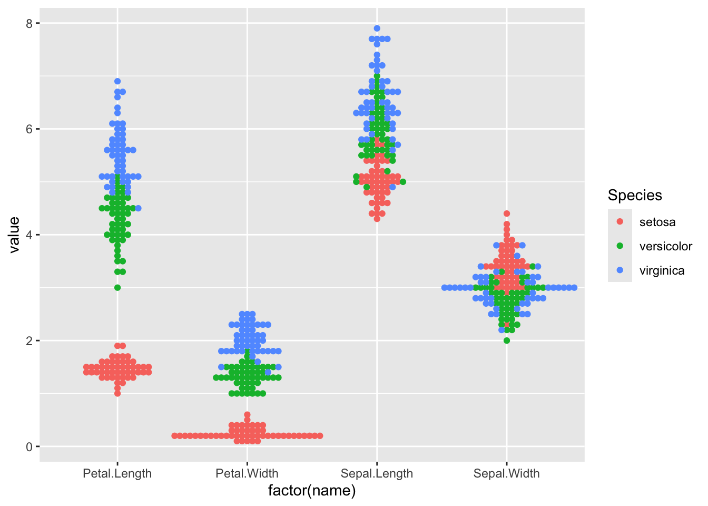

# Exercises for BST260 2026, November 9 2026

1.  Add a folder called quizzes to your bst260 github repository.

2.  Start a quarto document called `nov9.qmd` there.

3.  Put your solutions to these problems in that document. Make sure it
    renders.

Problem 1. Consider

``` r

library(ggplot2)
library(tidyr)
library(ggbeeswarm)
ggplot(pivot_longer(iris, cols=1:4), 
   aes(x=factor(name), y=value, colour=Species)) + geom_beeswarm()
```



Find thresholds on values of Petal.Length that can be used to classify
samples into species. For example, the vector `cutsl` here defines bins
into which irises can be classified using Sepal.Length. We can then
cross-classify the species labels and the three sepal-length based
categories.

``` r

cutsl = c(0,5.4,6,8)
with(iris, table(cut(Sepal.Length,cutsl),Species))
```

             Species
              setosa versicolor virginica
      (0,5.4]     45          6         1
      (5.4,6]      5         24         8
      (6,8]        0         20        41

Your job is to pick an iris feature and thresholds on length that reduce
the numbers of off-diagonal elements of this table, which represents a
“confusion matrix’.

Your answer will have the form

    feature = "..."
    cutsl = c(....)
    with(iris, table(cut( ..., cutsl), Species))

Problem 2.

This is a crude way of estimating proportion of births with low birth
weight outcomes as it varies by mother’s body weight.

``` r

library(MASS)
lm(low~I(cut(lwt,seq(0,300,50)))-1, data=birthwt)
```


    Call:
    lm(formula = low ~ I(cut(lwt, seq(0, 300, 50))) - 1, data = birthwt)

    Coefficients:
     I(cut(lwt, seq(0, 300, 50)))(50,100]  I(cut(lwt, seq(0, 300, 50)))(100,150]
                                    0.458                                  0.318
    I(cut(lwt, seq(0, 300, 50)))(150,200]  I(cut(lwt, seq(0, 300, 50)))(200,250]
                                    0.233                                  0.000  

Fit a two parameter model with `lm` that provides an estimate of the
proportion of births with low birth weight outcome for women with body
weight 150.
