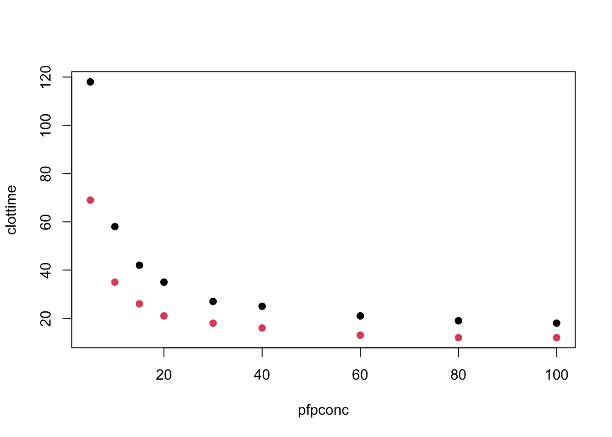

# modeling clotting time data

## Background

We have the clotting data set in glmmlpack260.

``` r

data("clotting", package="glmmlpack260")
with(clotting, plot(clottime~pfpconc, col=factor(lot), pch=19))
```


