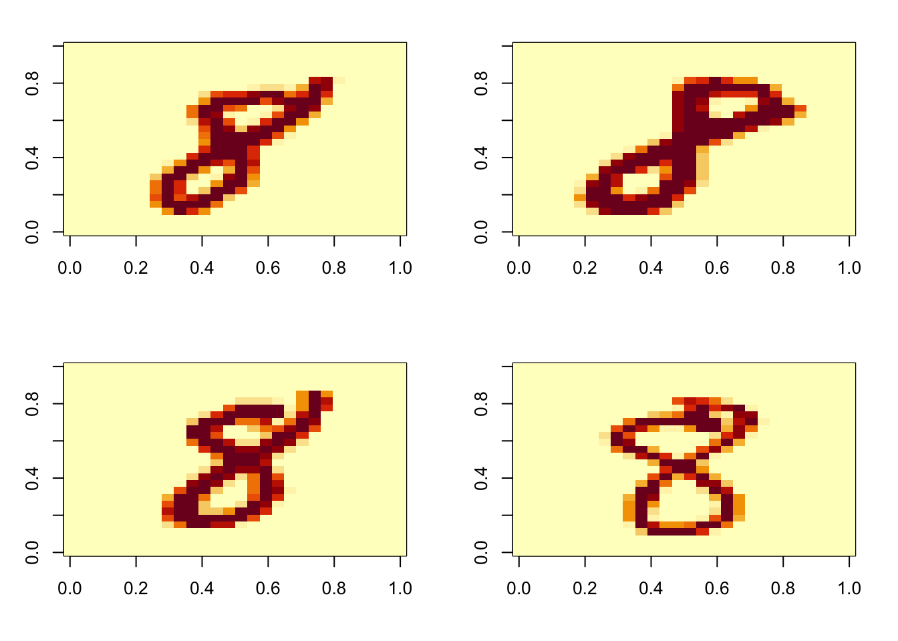
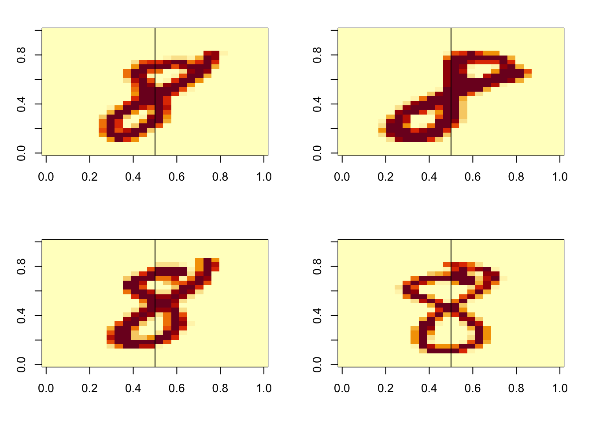
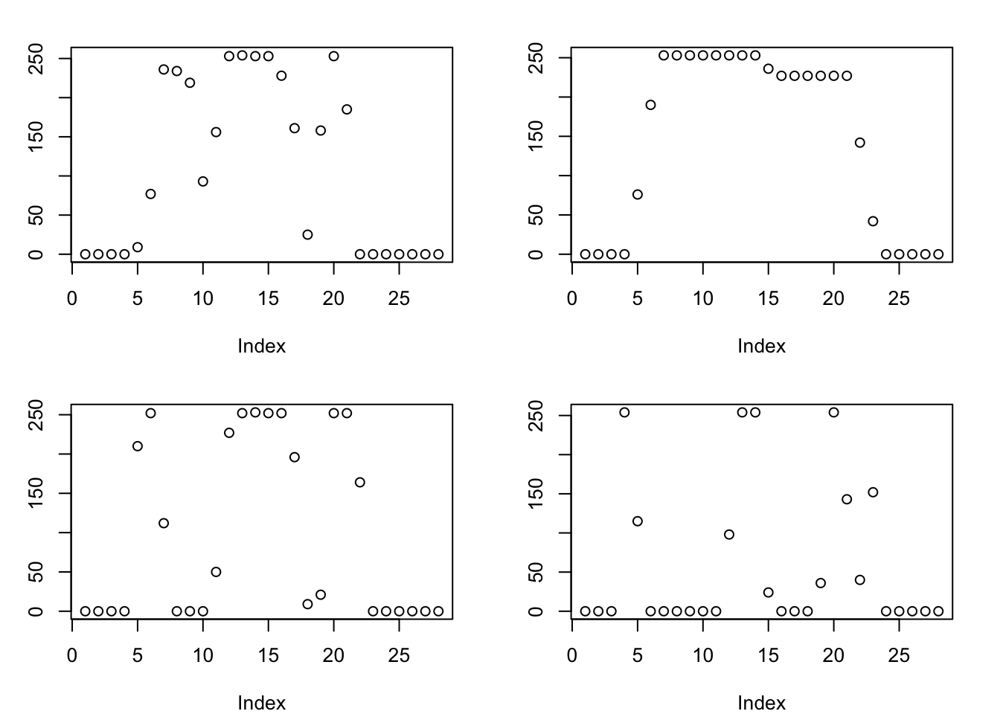
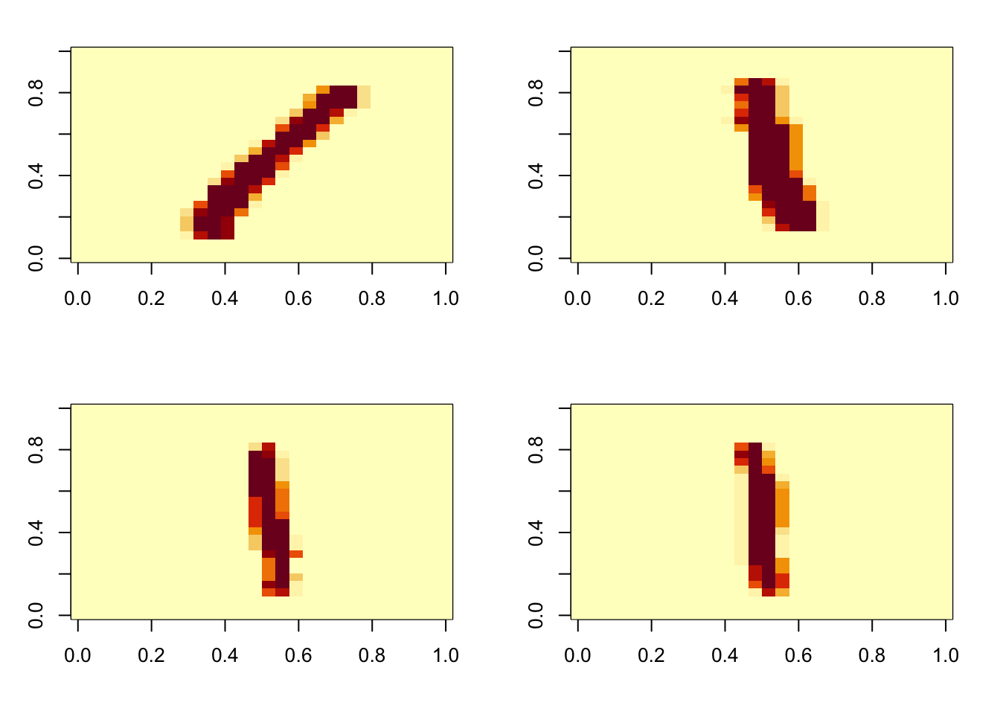
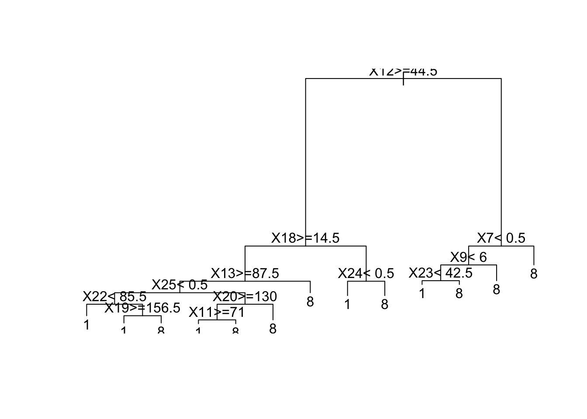

# a look at tree-based machine learning

## Background

We have the MNIST data consisting of digitized images of handwritten
arabic numerals.

``` r

data("mnist", package="glmmlpack260")
str(mnist)
```

    List of 2
     $ train:List of 2
      ..$ images: int [1:60000, 1:784] 0 0 0 0 0 0 0 0 0 0 ...
      ..$ labels: int [1:60000] 5 0 4 1 9 2 1 3 1 4 ...
     $ test :List of 2
      ..$ images: int [1:10000, 1:784] 0 0 0 0 0 0 0 0 0 0 ...
      ..$ labels: int [1:10000] 7 2 1 0 4 1 4 9 5 9 ...

``` r

mt8ind = which(mnist$train$labels==8)
imgs8 = mnist$train$images[mt8ind,]
par(mfrow=c(2,2),mar=c(4,3,2,2))
for (i in 1:4) image(matrix(imgs8[i,], 28)[,28:1])
```



Each image has 784 = 28 x 28 intensity values from 0 to 255. R’s `image`
function can help us recognize the variability in handwritten numerals.

That computers can perform handwriting recognition is well-established.
How do they do it? We will examine steps towards an answer.

## Feature exploration

The images present a “human readable” view of the data. One “feature” of
interest is the pattern of intensity along a line in the “middle” of the
image.

``` r

par(mfrow=c(2,2),mar=c(4,3,2,2))
for (i in 1:4) {
   image(matrix(imgs8[i,], 28)[,28:1])
   abline(v=.5)
}
```



We can extract the data values corresponding to this “middle” line and
plot the intensities.

``` r

par(mfrow=c(2,2),mar=c(4,3,2,2))
for (i in 1:4) {
   plot(matrix(imgs8[i,], 28)[,28:1][14,]) # why?
}
```



The intent here is to identify the “column” of the image matrix that
exhibits three peaks of intensity.

It turns out that the 15th “column” of the image matrix will exhibit the
three peaks characteristic of a vertical scan of the handwritten “8”. We
need the indices into the 784-column matrix of thousands of numerals
that have been scanned.

``` r

lineinds = which(((matrix(0:783 %% 28, 28))+1)==15) 
imgs8[1:4, lineinds]
```

         [,1] [,2] [,3] [,4] [,5] [,6] [,7] [,8] [,9] [,10] [,11] [,12] [,13] [,14]
    [1,]    0    0    0    0    0    0    0  185  253   137     0    11    80   253
    [2,]    0    0    0    0    0  154  253  253  253   253   253   253   253   253
    [3,]    0    0    0    0    0   43  246  252  147     0     0    48   232   252
    [4,]    0    0    0    0    0  203  172  252  254   120     0     0     0   129
         [,15] [,16] [,17] [,18] [,19] [,20] [,21] [,22] [,23] [,24] [,25] [,26]
    [1,]   253   254   253   253   253   253   254   154     0     0     0     0
    [2,]   253   253   253   253   253   253   231   150    14     0     0     0
    [3,]   253   231    48     0     0     0    43   246   252    32     0     0
    [4,]   254   254   190    13     0     0     0     0     0   135   254     0
         [,27] [,28]
    [1,]     0     0
    [2,]     0     0
    [3,]     0     0
    [4,]     0     0

We propose the 28 features identified in this way as sufficient to
identify an “8”. Surely we can do better, but let’s see if this is a
useful setp.

## Exercise 1.

Produce four images for the numeral 1.

``` r

mt1ind = which(mnist$train$labels==1)
imgs1 = mnist$train$images[mt1ind,]
par(mfrow=c(2,2),mar=c(4,3,2,2))
for (i in 1:4) image(matrix(imgs1[i,], 28)[,28:1])
```



Build a tree-structured classifier.

``` r

newdat = data.frame(num="8", imgs8[, lineinds])
newdat = rbind(newdat, data.frame(num="1", imgs1[, lineinds]))
newdat$num = factor(newdat$num)
library(rpart)
```

    1/0 packages newly attached/loaded, see sessionInfo() for details.

``` r

t1 = rpart(num~., data=newdat)
t1
```

    n= 12593

    node), split, n, loss, yval, (yprob)
          * denotes terminal node

     1) root 12593 5851 1 (0.53538 0.46462)
       2) X12>=44.5 8342 2333 1 (0.72033 0.27967)
         4) X18>=14.5 7041 1390 1 (0.80258 0.19742)
           8) X13>=87.5 6857 1233 1 (0.82018 0.17982)
            16) X25< 0.5 5363  698 1 (0.86985 0.13015)
              32) X22< 85.5 2536  151 1 (0.94046 0.05954) *
              33) X22>=85.5 2827  547 1 (0.80651 0.19349)
                66) X19>=156.5 2473  310 1 (0.87465 0.12535) *
                67) X19< 156.5 354  117 8 (0.33051 0.66949) *
            17) X25>=0.5 1494  535 1 (0.64190 0.35810)
              34) X20>=130 1102  209 1 (0.81034 0.18966)
                68) X11>=71 1002  127 1 (0.87325 0.12675) *
                69) X11< 71 100   18 8 (0.18000 0.82000) *
              35) X20< 130 392   66 8 (0.16837 0.83163) *
           9) X13< 87.5 184   27 8 (0.14674 0.85326) *
         5) X18< 14.5 1301  358 8 (0.27517 0.72483)
          10) X24< 0.5 423   92 1 (0.78251 0.21749) *
          11) X24>=0.5 878   27 8 (0.03075 0.96925) *
       3) X12< 44.5 4251  733 8 (0.17243 0.82757)
         6) X7< 0.5 1054  370 1 (0.64896 0.35104)
          12) X9< 6 766   95 1 (0.87598 0.12402)
            24) X23< 42.5 681   21 1 (0.96916 0.03084) *
            25) X23>=42.5 85   11 8 (0.12941 0.87059) *
          13) X9>=6 288   13 8 (0.04514 0.95486) *
         7) X7>=0.5 3197   49 8 (0.01533 0.98467) *

``` r

plot(t1)
text(t1)
```


